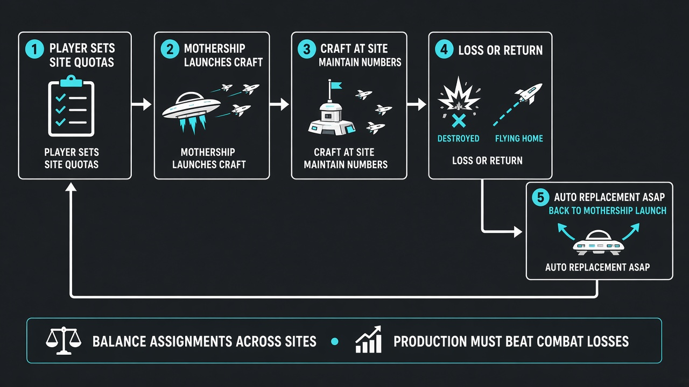
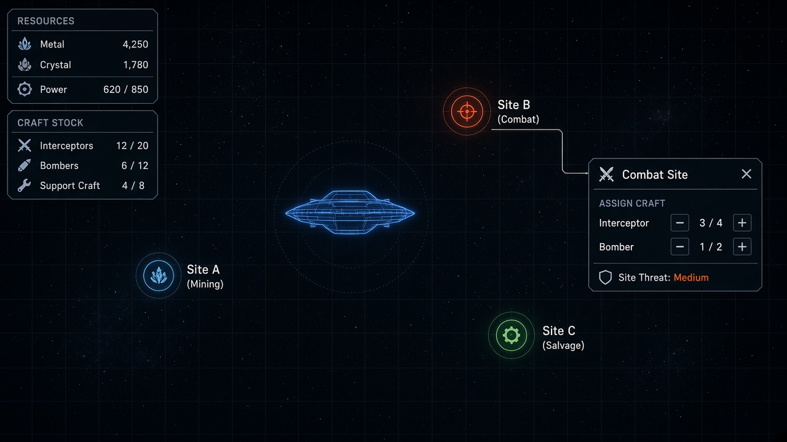
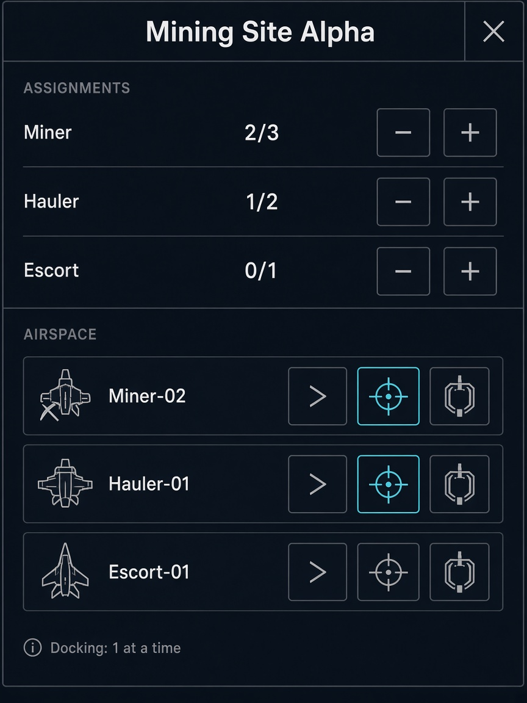
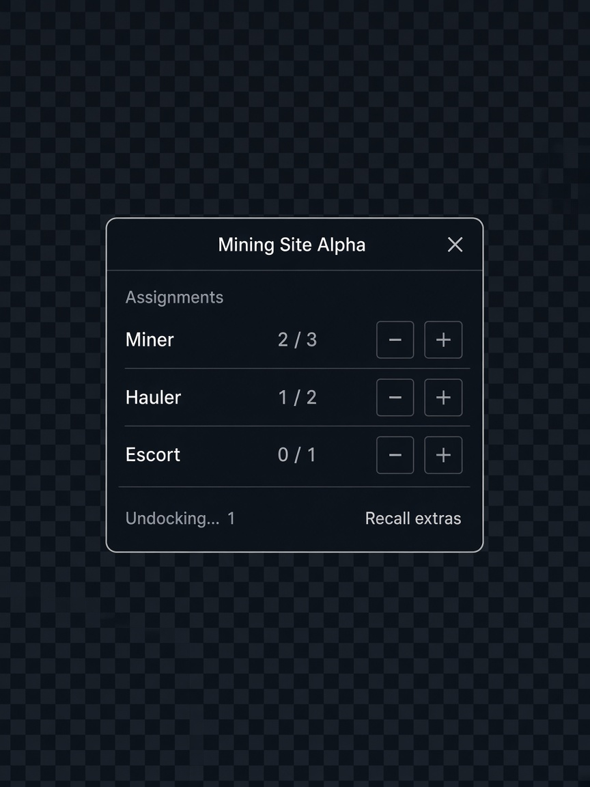
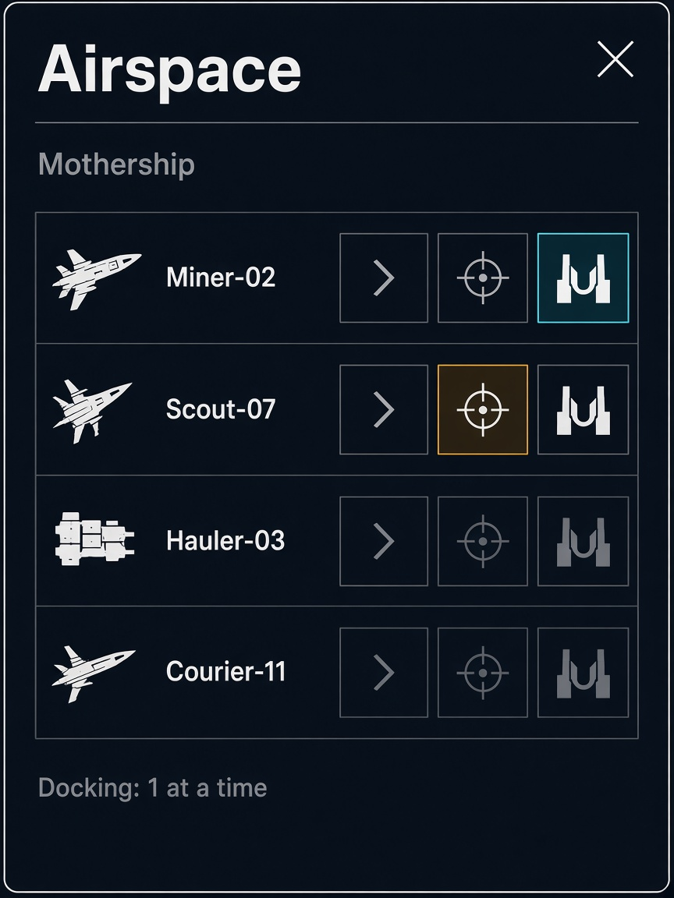

# Design Dock

**Status:** v0.6  
**Engine:** Blazium / Godot 4.3  
**Last updated:** 2026-10-18

This file is the source of truth. Change the doc before changing the fantasy in code.  
Concept images live in [`design/`](design/).

---

## 1. Pitch

A **grand-strategy-style** space game on a persistent **map**. You move a **mothership**, click **sites** for **popups**, and set **craft quotas**. Craft pass through **airspace windows** (mothership and site) in **phases**; when phases finish they **leave airspace** and either **join the site** or **return to the mothership**. Mining craft cycle site work → haul home → drop off. Balance assignments and keep production ahead of combat losses.

---

## 2. Pillars

| Pillar | Intent |
|--------|--------|
| **Map first** | The strategic map is always the main view. |
| **Combined popups** | Site and mothership each use **one popup**: assignments (or hangar) **plus** airspace queue in the same panel. |
| **Airspace queue** | Inside that popup: craft list with icon phases; one dock/undock at a time. |
| **Phases, then exit** | Craft move between phases inside airspace; when complete they leave the window → site roster or mothership hangar. |
| **Quota, not micro** | Player sets counts; systems fill and cycle craft. |
| **Mine → haul home** | Gather at site → return via airspaces → drop off at mothership → go back. |
| **Auto replenish** | Losses free quota slots; mothership fills asap if stock allows. |
| **Mothership as avatar** | Movable hub: hangar, build, drop-off, mothership airspace. |

---

## 3. Core loop (locked)

```
Move mothership
    → Click site → assign quotas
    → Craft enter mothership airspace → phases → leave airspace → transit
    → Enter site airspace → phases → leave airspace → join site
    → Work (e.g. mine) → leave site into site airspace → phases → transit home
    → Enter mothership airspace → phases → leave airspace → hangar / drop-off
    → Losses → send replacements through the same airspace path
```



---

## 4. UI model (locked)

| Layer | Role |
|-------|------|
| **Map (always on)** | Mothership, sites, craft in long transit between airspaces |
| **Site popup** | **One panel:** Assignments (top) + Airspace queue (bottom) |
| **Mothership popup** | **One panel:** Hangar / build / inventory (top) + Airspace queue (bottom) |
| **HUD** | Minimal chrome |

**Not the model:** full-screen tabs; separate floating airspace-only windows.





*Same window pattern for sites and mothership: management section + airspace docking queue.*

Older split mockups (assignments-only / airspace-only) are superseded by the combined panel:





---

## 5. Airspace (inside the popup) (locked)

Both the **mothership** and every **site** expose airspace as the **lower section of their popup** — not a second window.

### What it is
- A **docking queue list** in that popup: when a craft enters airspace it is **added to the list**.
- Each row is one craft; the list order is the queue.
- Craft are **not yet** fully in hangar / fully on-site while listed.
- When all phases for that visit are done, the craft **leaves the list** and either **joins the site** or **returns to the mothership** (hangar / drop-off).

### Phases (icons only — locked)

Three phases, shown as **icons** (no phase names in UI). Meaning is learned by play, not labels.

| Order | Intent (design only — not shown as text) | Icon idea |
|-------|------------------------------------------|-----------|
| 1 | Approaching **or** leaving | Motion / chevron |
| 2 | Aligning | Crosshair / parallel marks |
| 3 | Docking **or** undocking | Clamp / dock |

- Each craft row shows **three phase indicators**; the **current** phase is highlighted.
- Phases are approximate steps, not exact simulation jargon.

### Docking queue rule (locked)

- **Only one craft at a time** may be in the **docking / undocking** phase (phase 3).
- Other craft wait in the list (still showing phase 1 or 2, or idle until the dock slot frees).
- The airspace list **is** the docking queue.

### Two airspaces on a trip

```
Hangar
  → Mothership airspace (queue + phases) → leave list → map transit
  → Site airspace (queue + phases) → leave list → Join site

Site (working)
  → Site airspace → leave list → map transit
  → Mothership airspace → leave list → Hangar / drop-off
```

### Rules

| Rule | Behavior |
|------|----------|
| **No teleport** | Always through airspace queue + phases. |
| **Exit = resolve** | Leaving the list → join site or return to mothership. |
| **Dock lock** | Single docking/undocking slot per airspace. |
| **Quota accounting** | Pipeline vs on-station display TBD (D12). |

---

## 6. Mothership (locked)

- Player **moves** the mothership on the map.
- **Builds / stores** craft in hangar.
- **Mothership airspace** handles launch (to sites) and recovery (from sites), including mining **drop-off** during inbound phases or on hangar return.
- Under-quota sites get new craft sent through mothership airspace **asap** when hulls are free.

---

## 7. Sites (locked)

- Sites on the map; click → popup (assignments + **site airspace**).
- Quotas drive how many craft should be committed to the site.
- Craft only **join the site** after finishing site-airspace phases.

### Assignment & replenishment

| Rule | Behavior |
|------|----------|
| **Quota** | Desired craft counts |
| **Fill** | Hangar → mothership airspace → transit → site airspace → join site |
| **Loss** | Destroyed on-site → slot free → send replacement through airspaces |
| **Unassign / recall** | Extras depart site airspace → transit → mothership airspace → hangar |

### Mining cycle

```
Joined site → mine / load
    → Site airspace (depart phases) → transit
    → Mothership airspace (recover / unload phases)
    → Leave airspace → drop-off banked at mothership
    → Mothership airspace (outbound) → transit → site airspace → join site again
```

Haul-home remains **assigned work**, not unassign. Raise miner quota for continuous on-site presence while others haul.

---

## 8. Economy & attrition

- Resources bank at mothership after inbound airspace / drop-off completes.  
- Combat consumes craft; rebuild + re-send through airspaces.  

---

## 9. Open decisions

| # | Topic |
|---|--------|
| D1 | Continuous move vs node travel for mothership |
| D2 | Range required to use airspaces / send craft |
| D3 | Site types and quotas |
| D4 | Abstract site resolution vs tactical layer |
| D5 | Mothership top section: hangar list vs build vs tabs inside the same popup |
| D6 | Map transit visibility between airspaces |
| D7 | Game name |
| D8 | Parallel craft in one airspace |
| D9 | Miner cargo / mine duration |
| D10 | Phase durations / whether approach+align can run in parallel across craft |
| D11 | Visual icons final art for the three phases |
| D12 | UI: show pipeline craft in quota as “2 on-site · 1 in airspace” |

---

## 10. Non-goals (for now)

- Full-screen modes replacing the map  
- Instant hangar ↔ site with no airspace  
- Mining that banks without mothership recovery  
- Manual phase-by-phase clicking as the core skill  

---

## 11. Vertical slice

1. Map + movable mothership.  
2. Site popup with quotas.  
3. Craft: hangar → **mothership airspace phases** → transit → **site airspace phases** → join site.  
4. Mine → site airspace → transit → mothership airspace → drop-off → back.  
5. Loss → replacement through airspaces.  

---

## 12. Glossary

| Term | Meaning |
|------|---------|
| Combined popup | Single site or mothership panel: management + airspace |
| Airspace | Docking-queue section inside that popup |
| Phase | One of three icon steps: approach/leave → align → dock/undock |
| Docking queue | The airspace list; one craft in dock/undock at a time |
| Leave airspace | Removed from list → joins site or returns to mothership |
| Join site | Craft becomes on-station at the site |
| Return to mothership | Inbound queue done → hangar / cargo delivered |

---

*v0.6 — site/mothership combined popup (assignments/hangar + airspace queue).*
